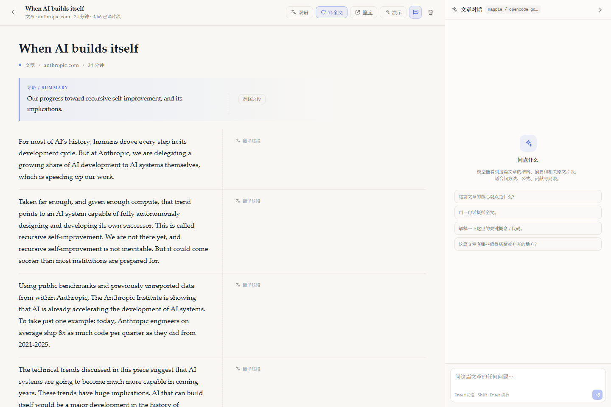
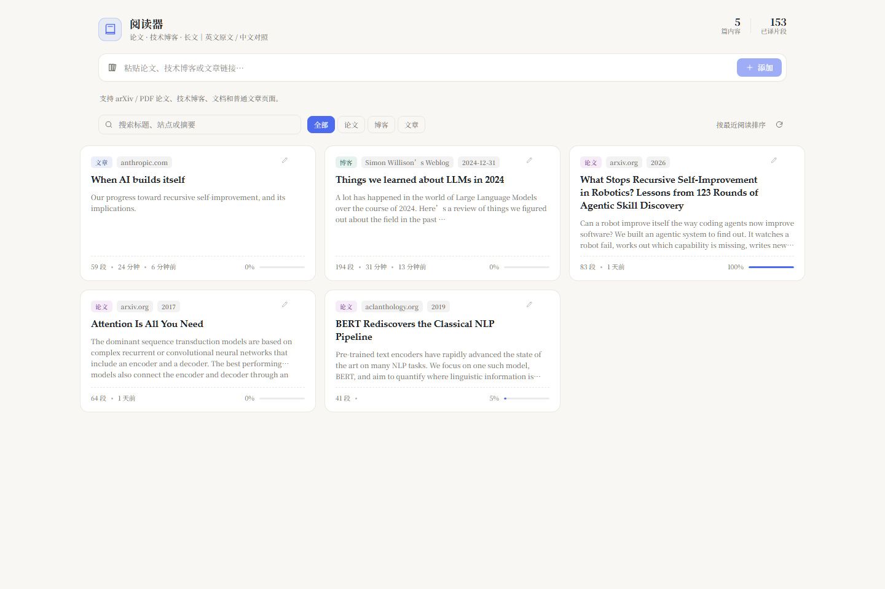
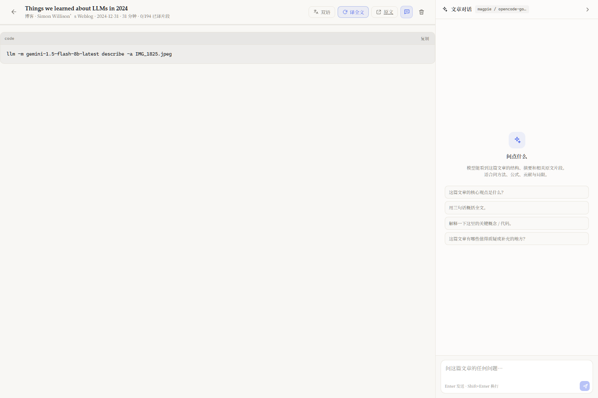
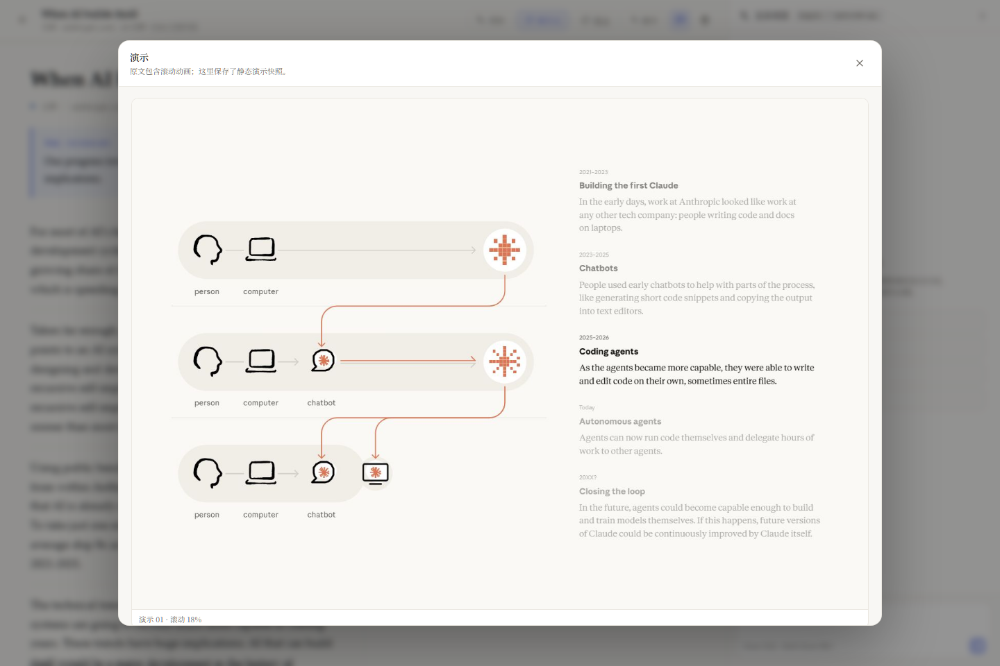
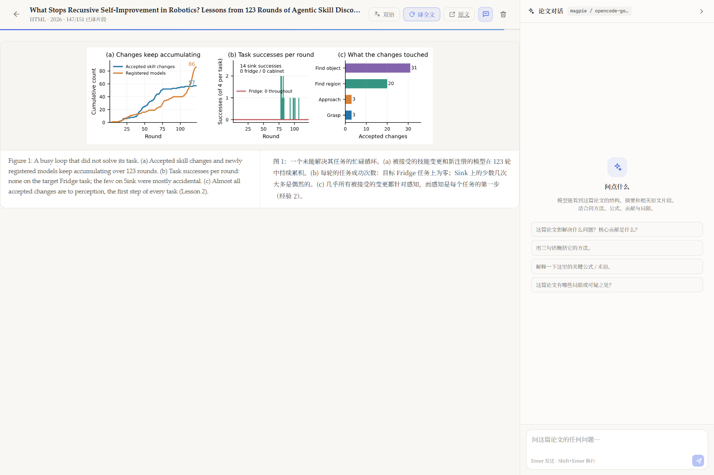
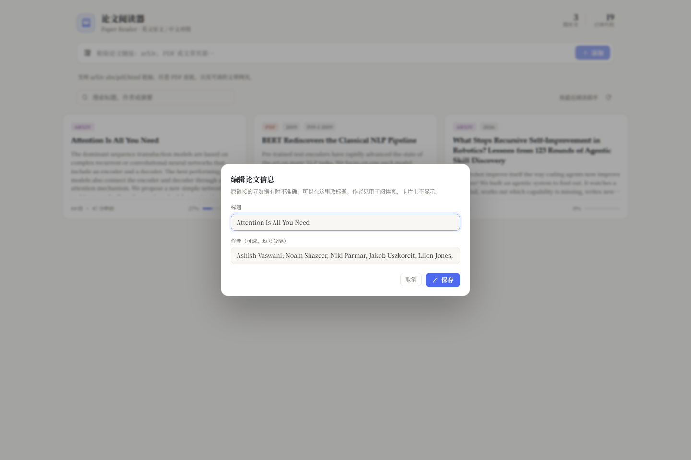
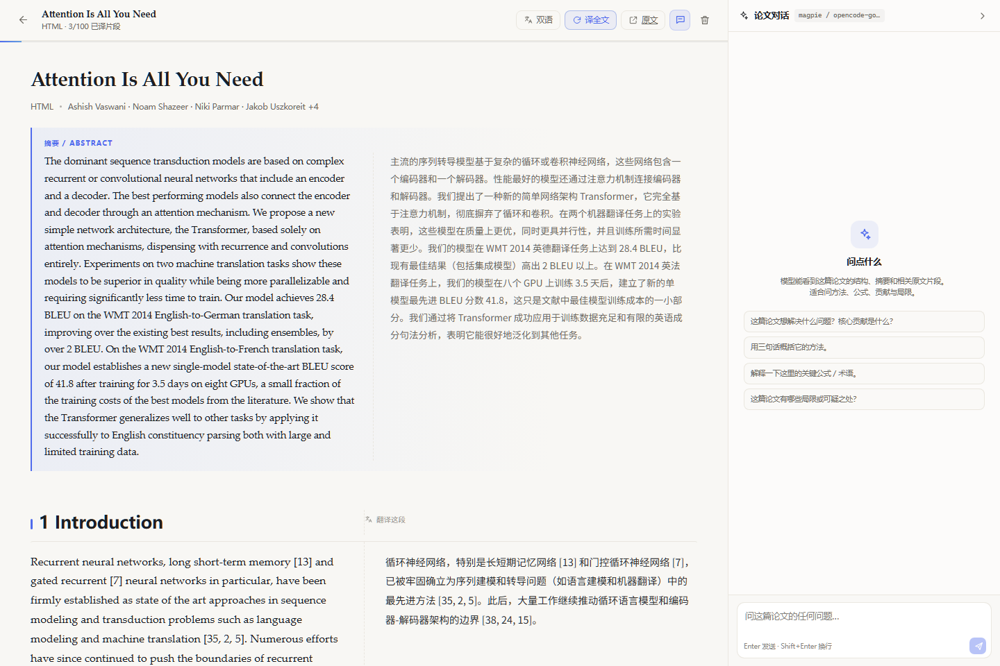

# dsh-plugin-paper-reader

[](https://github.com/deepseek-ai/deepseek-harness)
[](https://github.com/awesome-dsh-plugin/awesome-dsh-plugin)
[](LICENSE)

**A Zotero-like reading library for DeepSeek Harness.** Keep papers, tech blogs, docs and long reads on one shelf; read the English original on the left and a Simplified-Chinese translation on the right in **one shared scrollbar**; ask a chat rail that sees the text.

English | [简体中文](README.zh.md)



> **Developer preview.** DeepSeek Harness is in developer preview and its plugin APIs still change. This plugin is developed against the current DSH developer preview; pin a commit if you need a stable install.

## Why this plugin

Most "read it later" tools stop at a bookmark, and most translation tools lose the page. This plugin keeps the page's **structure** — headings, lists, code, figures, captions — and puts a cached, paragraph-aligned Chinese translation next to it. The paper/blog never leaves DSH: the panel, the translation model and the chat model all run through the harness you already have.

It is one reader, not two products: arXiv papers and tech blogs share the same shelf, the same bilingual layout and the same chat.

## Features

- **One shelf for papers and blogs** — paste an arXiv / PDF / article link. Cards show type (paper / blog / article), site, date and reading time; filter the shelf by type.
- **Bilingual parallel reading** — paragraph-level alignment in a single scroll container, so the columns cannot drift. The Chinese column follows DSH's own UI font (`--dsw-font-family`), including `dsh-fonttune` overrides.
- **Blog structure preserved** — headings, ordered/unordered lists, blockquotes, inline images and **code blocks** (monospace, horizontal scroll, copy button, never translated).
- **Figures and images** — HTML ``, `<object>` SVG and inline SVG are downloaded into the item's folder and rendered at their original position; figure captions are translated like any other block.
- **Static demo snapshots** — pages whose visuals are driven by scroll/canvas cannot run inside the reader. A `snapshots` gallery can attach static frames to an item (the screenshot shows Anthropic's *When AI builds itself*); frames are captured separately, and **原文** always opens the live page.
- **Editable cards** — fix a title the source page got wrong; authors are editable but hidden on cards (they still appear in the reader header).
- **Metadata that survives** — arXiv `abs` metadata, Open Graph, `article:published_time`, JSON-LD and `<time>` are used for title/author/date/site. Re-adding an existing link repairs missing metadata and figures without touching cached translations.
- **PDF layout analysis** — an XY-cut pass rebuilds paragraphs and reading order for single- and two-column papers.
- **Translation through DSH** — batches call `ctx.llm.stream` with the model selected in DSH; results are cached per block in `zh.json`. Visible blocks translate lazily; **译全文** translates the rest. Code, images and references are skipped.
- **Article chat** — the right rail streams answers from DSH's model. The prompt carries the summary, outline and the passages most relevant to the question, and cites block ids such as `[§3.2 · b42]`.
- **Agent-visible** — the host registers `paper_list`, `paper_read` and `paper_add`, so any DSH session can read what the reader is showing.
- **Same-origin and local-first** — the UI talks only to the DSH web server; papers, translations, images and chat history stay under `~/.dsh/paper-reader`.

## Screenshots

| Library with type filters | Tech blog with code blocks |
| --- | --- |
|  |  |

| Interactive demo snapshots | Figure with bilingual caption |
| --- | --- |
|  |  |

| Card metadata editor | Bilingual paper reader |
| --- | --- |
|  |  |

## Install

### From GitHub

```sh
dsh plugin --profile web add github:Tulipe1735/dsh-plugin-paper-reader
```

Use `--profile desktop` instead of `web` for the desktop profile. The repository ships a prebuilt `client.js`; no frontend build is required for installation.

### From the marketplace

Submitted to the [Awesome DeepSeek Harness Plugins](https://github.com/awesome-dsh-plugin/awesome-dsh-plugin) list. Once merged, search for **dsh-plugin-paper-reader** in DSH's plugin marketplace and install it there.

### Local development

```sh
git clone https://github.com/Tulipe1735/dsh-plugin-paper-reader.git
cd dsh-plugin-paper-reader
pnpm install
```

Then mount it in a profile:

```yaml
# ~/.dsh/profiles/desktop/cordis.patch.yml
- insert:
    - id: dsh-plugin-paper-reader
      name: 'dsh-plugin-paper-reader'
```

and add the link dependency to that profile's `package.json`:

```json
{
  "dependencies": {
    "dsh-plugin-paper-reader": "link:C:/path/to/dsh-plugin-paper-reader"
  }
}
```

The host half is plain ESM; the client is loaded through DSH's module loader.

## Usage

1. Open the **阅读** (Reader) book icon in DSH's sidebar.
2. Paste a link:
   - `https://arxiv.org/abs/1706.03762`
   - `https://arxiv.org/pdf/1810.04805`
   - `https://www.anthropic.com/institute/recursive-self-improvement`
   - `https://simonwillison.net/2024/Dec/31/llms-in-2024/`
   - any readable article URL
3. The reader opens. The first blocks translate automatically; scroll to translate more, or press **译全文**.
4. Click a paragraph to reference it, select text to quote it, then ask in the right rail.
5. Hover a card and press the **pencil** to fix its title or authors.
6. For a page with scroll animations, press **演示** for the static snapshot gallery, or **原文** for the live page.
7. **双语 / 原文 / 译文** cycles the display mode.

## What is supported

| Source | Text | Figures | Code | Notes |
| --- | --- | --- | --- | --- |
| arXiv HTML | Yes | HTML figures | Yes | Preferred full-text route |
| arXiv PDF | Yes | Not extracted | No | XY-cut paragraph/column rebuild |
| Direct PDF | Yes | Not extracted | No | Scanned PDFs without a text layer are reported |
| Tech blog / docs | Yes | Inline images and figures | Yes | Readability + metadata fallbacks |

## How it works

```text
DSH Web UI
  └─ paper-reader panel (client.js, React)
       └─ same-origin /plugins/dsh-plugin-paper-reader/api/*
            ├─ add      → fetch → Readability / arXiv / pdf.js → figures
            ├─ translate→ ctx.llm.stream → per-block cache (zh.json)
            ├─ chat     → summary + outline + relevant blocks → SSE
            └─ store    → ~/.dsh/paper-reader
```

The plugin is a normal Cordis plugin: it registers a web-server prefix, a sidebar panel and three agent tools. It does not start a second server and does not proxy model calls outside DSH.

## Data

Everything lives under `$DSH_HOME/paper-reader` (default `~/.dsh/paper-reader`):

| Path | Content |
| --- | --- |
| `library.json` | shelf index (type, site, title, authors, date, counts, reading time) |
| `papers/<id>/paper.json` | metadata + blocks (`b1`, `b2`, …) |
| `papers/<id>/zh.json` | cached Chinese translations keyed by block id |
| `papers/<id>/chat.json` | last 80 chat turns |
| `papers/<id>/source.pdf` | original PDF, served by `/api/source` |
| `papers/<id>/figures/` | downloaded HTML/blog images, served by `/api/figure` |
| `papers/<id>/snapshots/` | optional static demo frames, served by `/api/snapshot` |

Deleting an item removes its folder. To back up the library, copy that directory.

## Build and test

```sh
pnpm install
pnpm build        # esbuild → .build/app.cjs → wrapped into client.js
pnpm test         # happy-dom smoke test for the client half
pnpm test:extract # PDF extraction fixture
```

`client.js` is generated; edit `src/**` and run `pnpm build`. The host half (`index.js`, `lib/**`) is plain ESM and needs no build step.

## Security and privacy

- `api/*` enforces same-origin `Sec-Fetch-Site` / `Origin` / `Referer` checks.
- URL fetching blocks loopback / private-network hosts, caps downloads at 48 MB and redirects at 60 s.
- HTML is reduced to text; the reader never injects page HTML. Chat Markdown renders text, links and code only.
- Figures and snapshots are served as images from the item's own folder; SVG is rendered through ``, so scripts inside it do not execute.
- No model keys are stored by the plugin; translation and chat use the model selected in DSH.

## Limitations

- **PDF figures** are not extracted yet; use **原文** to view the PDF.
- **JavaScript-only or paywalled pages** may yield partial text if the server HTML does not contain the article.
- **Interactive demos** are static snapshots, not live components. **原文** is the live experience.
- **OCR** for scanned PDFs is out of scope.
- The plugin targets the current DSH developer preview; breaking changes in DSH's plugin APIs may require an update.

## Contributing

Issues and pull requests are welcome. Please keep the `dsh.bundle` manifest and `cordis.patch.yml` intact, run `pnpm test` and `node --check` on host files before sending a change, and add the [`dsh-plugin`](https://github.com/topics/dsh-plugin) topic when forking for the marketplace.

## License

[MIT](LICENSE).

## Acknowledgements

Built on [DeepSeek Harness](https://github.com/deepseek-ai/deepseek-harness) and [Cordis](https://github.com/cordiverse/cordis). HTML extraction uses [Readability](https://github.com/mozilla/readability) and [linkedom](https://github.com/WebReflection/linkedom); PDF extraction uses [pdf.js](https://github.com/mozilla/pdf.js). Screenshots include short excerpts from third-party articles for demonstration only; the original authors retain all rights to that content.
