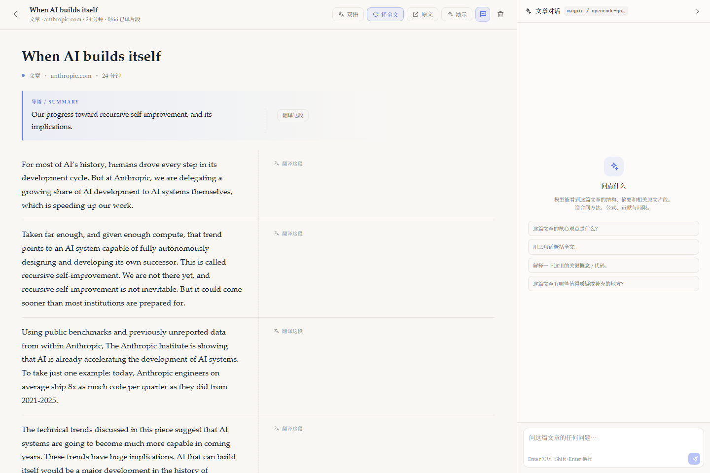
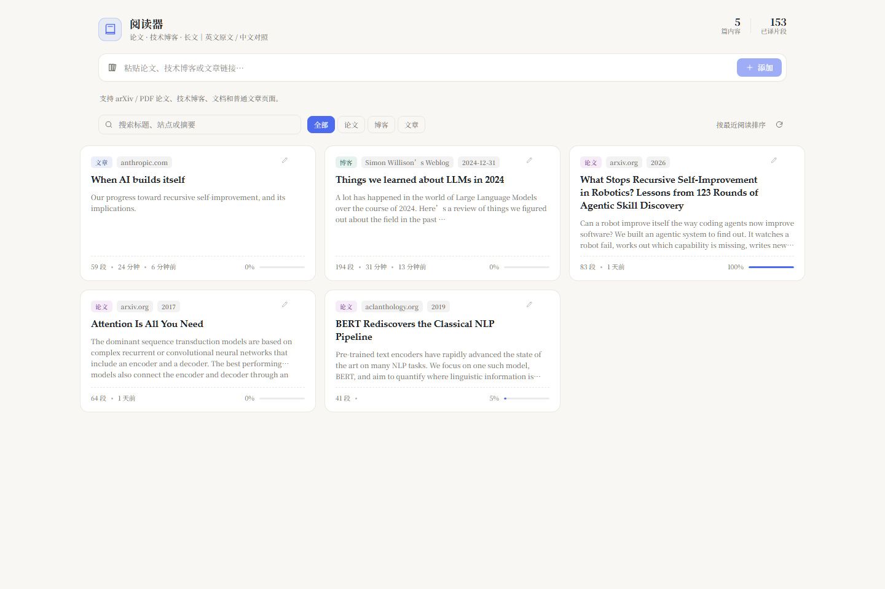
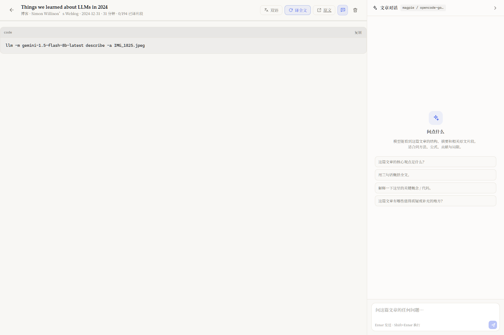
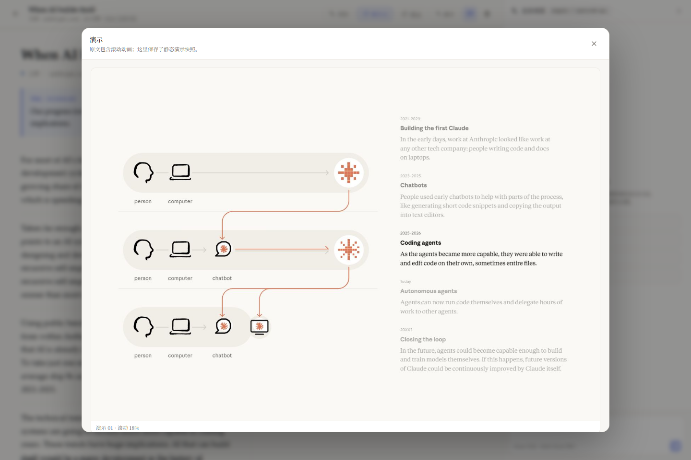
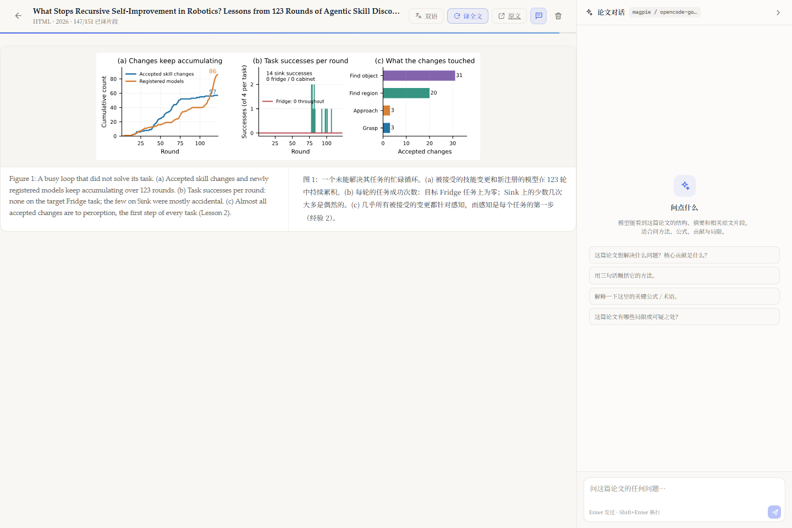
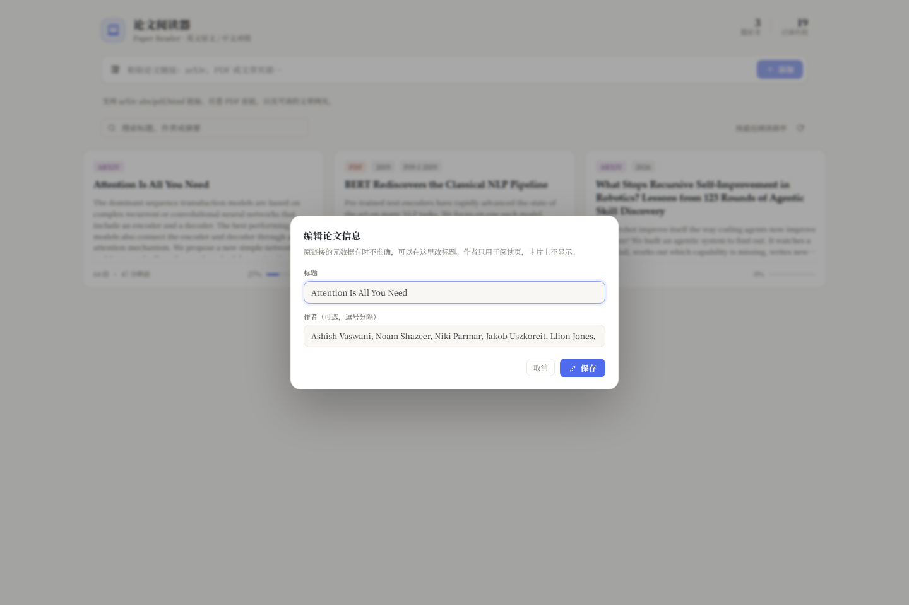
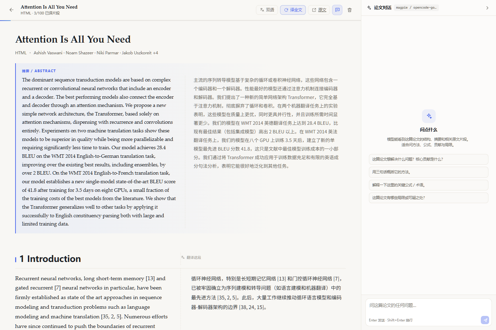

# dsh-plugin-paper-reader

[](https://github.com/deepseek-ai/deepseek-harness)
[](https://github.com/awesome-dsh-plugin/awesome-dsh-plugin)
[](LICENSE)

**给 DeepSeek Harness 用的 Zotero 式阅读库。** 把论文、技术博客、文档和长文放在同一个书架里；左边英文原文、右边简体中文对照，**共用一个滚动条**；右侧还能让 DSH 的模型基于正文回答问题。

[English](README.md) | 简体中文



> **开发者预览。** DeepSeek Harness 仍在快速迭代，插件 API 可能变化。本项目基于当前 DSH 开发者预览开发；需要稳定安装时请固定 commit。

## 为什么做这个插件

大多数“稍后读”工具只是收藏一个链接，大多数翻译工具又把网页本身弄丢了。这个插件保留原页面的**结构**——标题、列表、代码、插图和图注——再把逐段对齐、可缓存的中文翻译放在旁边。论文和博客不离 DSH：面板、翻译模型和对话模型都走你已有的 Harness。

它是一个阅读器，不是两个产品：arXiv 论文和技术博客共用同一个书架、同一套双语布局和同一个对话栏。

## 功能

- **论文和博客共用一个书架** — 粘贴 arXiv / PDF / 文章链接即可。卡片显示类型（论文 / 博客 / 文章）、站点、日期和阅读时长；书架支持按类型筛选。
- **双语并行阅读** — 逐段对齐，英文和中文在同一个滚动容器里，不会错位。中文列跟随 DSH 自己的界面字体（`--dsw-font-family`），也支持 `dsh-fonttune` 覆盖。
- **保留博客结构** — 标题、有序/无序列表、引用、正文插图和**代码块**（等宽字体、横向滚动、一键复制、不参与翻译）都会按原顺序保留。
- **插图和图注** — HTML 的 ``、`<object>` SVG 和内联 SVG 会下载到条目自己的目录，在原位置显示；图注照常左英右中。
- **静态演示快照** — 滚动/Canvas 驱动的交互动画无法在阅读器里直接运行。条目可以挂一个 `snapshots` 画廊来保存关键帧（截图中是 Anthropic 的 *When AI builds itself*）；帧需要单独抓取，**原文**始终打开实时页面。
- **卡片可编辑** — 原页面标题识别错时可以直接改；作者可编辑，但**不在卡片上显示**（阅读页顶部仍显示）。
- **元数据兜底** — 使用 arXiv `abs` 元数据、Open Graph、`article:published_time`、JSON-LD 和 `<time>` 识别标题/作者/日期/站点。重复添加旧链接会在原地修复缺失的元数据和图片，不重新生成已有翻译。
- **PDF 版面分析** — XY-cut 重建单栏/双栏论文的段落和阅读顺序。
- **通过 DSH 翻译** — 按批调用 `ctx.llm.stream`，使用 DSH 中当前选择的模型；结果按块缓存在 `zh.json`。可见段落随滚动懒翻译，**译全文**翻译剩余部分。代码、图片和参考文献会跳过。
- **文章对话** — 右侧对话栏由 DSH 模型流式回答。提示词包含摘要、目录和最相关的原文片段，回答会引用块 id，例如 `[§3.2 · b42]`。
- **Agent 也能读** — Host 注册了 `paper_list`、`paper_read` 和 `paper_add`，任意 DSH 会话都能读取当前阅读器里的内容。
- **同源、本地优先** — 前端只与 DSH Web 服务器通信；论文、翻译、图片和对话记录都留在 `~/.dsh/paper-reader`。

## 截图

| 带类型筛选的书架 | 技术博客与代码块 |
| --- | --- |
|  |  |

| 交互页面静态快照 | 插图与双语图注 |
| --- | --- |
|  |  |

| 卡片编辑 | 论文双语阅读 |
| --- | --- |
|  |  |

## 安装

### 从 GitHub 安装

```sh
dsh plugin --profile web add github:Tulipe1735/dsh-plugin-paper-reader
```

桌面端把 `web` 换成 `desktop`。仓库已经包含预构建的 `client.js`，安装时不需要再构建前端。

### 从插件市场安装

已提交到 [Awesome DeepSeek Harness Plugins](https://github.com/awesome-dsh-plugin/awesome-dsh-plugin) 精选列表。合并后可在 DSH 的插件市场搜索 **dsh-plugin-paper-reader** 安装。

### 本地开发

```sh
git clone https://github.com/Tulipe1735/dsh-plugin-paper-reader.git
cd dsh-plugin-paper-reader
pnpm install
```

在 profile 的 `cordis.patch.yml` 中挂载：

```yaml
- insert:
    - id: dsh-plugin-paper-reader
      name: 'dsh-plugin-paper-reader'
```

并在该 profile 的 `package.json` 中加入：

```json
{
  "dependencies": {
    "dsh-plugin-paper-reader": "link:C:/path/to/dsh-plugin-paper-reader"
  }
}
```

Host 是普通 ESM；前端通过 DSH 的 module loader 加载。

## 使用

1. 点击 DSH 左侧栏的 **阅读** 书本图标。
2. 粘贴链接：
   - `https://arxiv.org/abs/1706.03762`
   - `https://arxiv.org/pdf/1810.04805`
   - `https://www.anthropic.com/institute/recursive-self-improvement`
   - `https://simonwillison.net/2024/Dec/31/llms-in-2024/`
   - 任意可读文章页面
3. 阅读器打开后，前几段会自动翻译；继续滚动会翻译更多，或点 **译全文**。
4. 点击段落可引用，选中文字可引用原文；然后在右侧提问。
5. 卡片悬停后点 **铅笔**，可修改标题或作者。
6. 带滚动动画的页面，点 **演示** 看静态快照，或点 **原文** 看实时页面。
7. **双语 / 原文 / 译文** 切换显示模式。

## 支持范围

| 来源 | 正文 | 插图 | 代码 | 说明 |
| --- | --- | --- | --- | --- |
| arXiv HTML | 支持 | HTML 插图 | 支持 | 优先的全文路线 |
| arXiv PDF | 支持 | 不抽取 | 不支持 | XY-cut 重建段落和分栏 |
| PDF 直链 | 支持 | 不抽取 | 不支持 | 无文字层的扫描件会明确报错 |
| 技术博客 / 文档 | 支持 | 正文图片与 figure | 支持 | Readability + 元数据兜底 |

## 工作原理

```text
DSH Web UI
  └─ paper-reader 面板（client.js，React）
       └─ 同源 /plugins/dsh-plugin-paper-reader/api/*
            ├─ add      → 抓取 → Readability / arXiv / pdf.js → 图片
            ├─ translate→ ctx.llm.stream → 按块缓存（zh.json）
            ├─ chat     → 摘要 + 目录 + 相关片段 → SSE
            └─ store    → ~/.dsh/paper-reader
```

插件就是一个普通 Cordis 插件：注册一个 web-server 前缀、一个侧边栏面板和三个 agent 工具。它不会另起服务器，也不会把模型请求代理到 DSH 之外。

## 数据

所有数据都在 `$DSH_HOME/paper-reader`（默认 `~/.dsh/paper-reader`）：

| 路径 | 内容 |
| --- | --- |
| `library.json` | 书架索引（类型、站点、标题、作者、日期、统计、阅读时长） |
| `papers/<id>/paper.json` | 元数据 + 内容块（`b1`、`b2`…） |
| `papers/<id>/zh.json` | 按块缓存的简体中文翻译 |
| `papers/<id>/chat.json` | 最近 80 轮对话 |
| `papers/<id>/source.pdf` | 原始 PDF，由 `/api/source` 提供 |
| `papers/<id>/figures/` | 下载的 HTML/博客图片，由 `/api/figure` 提供 |
| `papers/<id>/snapshots/` | 可选的静态演示帧，由 `/api/snapshot` 提供 |

删除条目会删除该目录。备份整个目录即可。

## 构建与测试

```sh
pnpm install
pnpm build        # esbuild → .build/app.cjs → 包装成 client.js
pnpm test         # happy-dom 前端冒烟测试
pnpm test:extract # PDF 抽取测试
```

`client.js` 是生成文件；修改 `src/**` 后运行 `pnpm build`。Host（`index.js`、`lib/**`）是普通 ESM，不需要构建。

## 安全与隐私

- `api/*` 校验同源 `Sec-Fetch-Site` / `Origin` / `Referer`。
- URL 抓取会阻止回环/内网地址，下载上限 48 MB，重定向上限 60 秒。
- HTML 只提取为文本，阅读器不注入原页面 HTML；对话 Markdown 只渲染文本、链接和代码。
- 插图和快照从条目自己的目录以图片形式提供；SVG 通过 `` 渲染，内部脚本不会执行。
- 插件不保存模型密钥；翻译和对话使用 DSH 当前选择的模型。

## 限制

- **PDF 插图**暂未抽取；需要看图请点 **原文**。
- **纯 JS 渲染或付费墙页面**，如果服务端 HTML 没有正文，只能抓到部分内容。
- **交互式演示**是静态快照，不是可点击的原组件；**原文**才是实时体验。
- **扫描版 PDF 的 OCR** 不在范围内。
- 插件跟随 DSH 开发者预览；DSH 插件 API 变化时可能需要更新。

## 参与贡献

欢迎 issue 和 PR。提交前请保持 `dsh.bundle` manifest 与 `cordis.patch.yml` 完整，运行 `pnpm test` 并对 Host 文件执行 `node --check`；如果 fork 后要提交市场，请给仓库加上 [`dsh-plugin`](https://github.com/topics/dsh-plugin) topic。

## 许可

[MIT](LICENSE)。

## 致谢

基于 [DeepSeek Harness](https://github.com/deepseek-ai/deepseek-harness) 与 [Cordis](https://github.com/cordiverse/cordis)。HTML 抽取使用 [Readability](https://github.com/mozilla/readability) 和 [linkedom](https://github.com/WebReflection/linkedom)；PDF 抽取使用 [pdf.js](https://github.com/mozilla/pdf.js)。截图中的第三方文章片段仅用于演示，版权归原作者所有。
